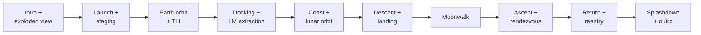
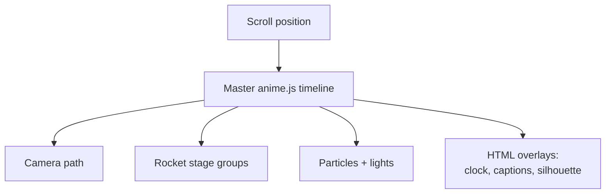
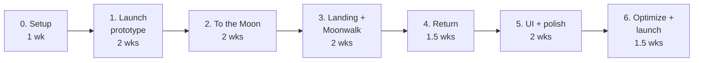

# Apollo 11 Interactive Journey — PRD

2026-09-22

## Overview

A single scroll-driven web page that replays the full Apollo 11 mission in 3D, from liftoff on July 16, 1969 to splashdown on July 24, with every stage separation animated.

The viewer scrolls, and one camera follows the spacecraft through 10 mission chapters. A mission clock (Mission Elapsed Time) advances with scroll, so the page feels like a replay rather than an article.

**Problem:** most Apollo 11 explainers are static diagrams or long videos. Neither lets people control the pace or see how the 110-meter Saturn V sheds itself down to one small capsule.

**Vision:** an experience where each jettisoned piece is visible, labeled and understandable, and the ending makes clear that only the Command Module came home.

## Goals, non-goals and success metrics

**Goals**

- Show all 10 mission chapters in one continuous, scroll-controlled 3D journey.
- Animate every separation event (12 in total) clearly enough that a first-time viewer can name what fell away.
- Keep one source of truth for timing: a single anime.js timeline drives the 3D scene and the HTML overlays.
- Run smoothly on a mid-range laptop and a recent phone.

**Non-goals**

- Physically accurate orbital simulation. Trajectories are stylized, not computed.
- A flight simulator or player control of the spacecraft.
- Coverage of other Apollo missions (possible later).

**Success metrics**

| Metric | Target |
| --- | --- |
| Frame rate, mid-range laptop | 60 fps sustained |
| Frame rate, recent phone | 30 fps or better |
| First meaningful paint | Under 3 s on 4G |
| Total page weight | Under 5 MB |
| Viewers reaching splashdown | 40% or more of those who start scrolling |
| Lighthouse accessibility score | 90 or higher |

## Story mode (NASA Space Apps, 2026-11)

**Scope change.** For the NASA Space Apps Challenge ("Abandoned but not forgotten"), the
default experience becomes a children's story, *The Monuments We Left Behind*, aimed at ages 6–9.

- **Narrators.** The Earth and the Moon tell the mission between them. The lonely Moon learns
  what humans left behind and ends as "a museum of human courage".
- **Collecting.** Children collect every piece the mission let go of in a Monument Album.
  They drop each stage themselves with a "Let go!" button, and see where every piece rests
  today on a map.
- **Scope of the layer.** It sits on top of the cinematic 3D replay. Two story-only chapters
  are added: a prologue in the Earth–Moon system and an epilogue at the whole Moon.
- **Classic mode.** The original 12+ experience remains available as `?story=0`.

| Decision | Choice |
| --- | --- |
| Audience | Ages 6–9, voice-first; short lines; touch targets of at least 56 px; text of at least 20 px |
| Narration | Pre-recorded voices, one file per line, with read-along word highlighting. Text-only until recorded |
| Devices | Tablet-friendly: big play, previous and next controls drive auto-advance; scroll stays the source of truth |
| Language | English only; all text is in data files, so translation is additive |
| Script | `docs/story.md` (line ids shared with the data and the audio files) |
| Facts | Corrected against NASA sources in the script's Sources section; the about panel labels what is stylised |

## Target audience

The primary audience is curious general visitors, aged roughly 12 and up, who know Apollo 11 landed on the Moon but not how the mission worked.

| Audience | What they want | Design implication |
| --- | --- | --- |
| General visitors | A memorable, visual story | Cinematic pacing, minimal jargon, short captions |
| Students and teachers | Accurate facts to learn from | Correct names, times and labels; a stage-jump menu for classroom use |
| Space enthusiasts | Detail and accuracy | Optional data cards (velocity, altitude, MET) and the lesser-known separations |
| Portfolio reviewers | Evidence of craft | Smooth 3D, polished motion, clean code |

## User experience

The page opens on the Saturn V at Pad 39A with a "Hold to launch" button; after a countdown, scrolling drives the rest of the mission.

Each arrow is a scroll section; the camera eases between them rather than cutting.

### Mission chapters

| # | Chapter | Key moment | Approx. MET |
| --- | --- | --- | --- |
| 1 | Launch | Liftoff from Pad 39A | T+0:00:00 |
| 2 | Staging | S-IC and S-II fall away | T+0:02:42 to T+0:09:10 |
| 3 | Earth orbit and TLI | S-IVB burns for the Moon | T+2:44 |
| 4 | Transposition and docking | Columbia docks with Eagle, extracts it | T+3:15 to T+4:17 |
| 5 | Translunar coast | Trajectory draws across Earth–Moon view | ~3 days |
| 6 | Lunar orbit insertion | Braking burn behind the Moon | T+75:50 |
| 7 | Descent and landing | 1202 alarms, low fuel, "The Eagle has landed" | T+102:45 |
| 8 | Moonwalk | First step, flag, experiments | T+109:24 |
| 9 | Ascent and rendezvous | Ascent stage lifts off, redocks | T+124:22 to T+128:03 |
| 10 | Return and splashdown | SM jettison, reentry, parachutes | T+195:18 |

MET values are approximate and must be checked against the NASA Apollo 11 Flight Journal before release.

### Separation events

Every separation follows the same four-beat rhythm, played in slow motion with a "SLOW-MO" badge:

1. Engine glow fades (cutoff).
2. Flashes at the joint (pyrotechnics, retro or ullage rockets), brief pause.
3. The spent piece drifts back and tumbles with slightly randomized rotation.
4. The next engine ignites and the camera eases forward.

| # | Event | Chapter | Note |
| --- | --- | --- | --- |
| 1 | S-IC separation | Staging | Retro-rockets push it back; S-II ullage fires |
| 2 | Interstage ring jettison | Staging | About 30 s after S-IC separation |
| 3 | Launch Escape Tower jettison | Staging | Own motor, takes the boost cover |
| 4 | S-II separation | Staging | S-IVB ignites to reach orbit |
| 5 | SLA panels open | Docking | Four panels peel away like petals |
| 6 | CSM separates from S-IVB | Docking | Turns 180° to dock |
| 7 | LM extracted, S-IVB discarded | Docking | S-IVB drifts off |
| 8 | LM undocks from CSM | Descent | Eagle and Columbia split |
| 9 | Ascent stage leaves descent stage | Ascent | Descent stage stays on the Moon |
| 10 | Ascent stage jettisoned | Ascent | After crew transfer |
| 11 | Service Module jettison | Return | Before reentry |
| 12 | Parachute sequence | Return | Heat shield cover, drogues, three mains |

### Persistent UI

- **Mission clock** in the corner, ticking with scroll.
- **Stack silhouette** that greys out each piece as it is jettisoned; by splashdown only the Command Module stays lit.
- **Stage rail** on the side to jump to any chapter.
- **Mini trajectory map** with a dot for current position from chapter 3 onward.

## Functional requirements

Must-haves ship in v1; should-haves ship if time allows; could-haves are post-launch.

| ID | Requirement | Priority |
| --- | --- | --- |
| FR-1 | Scroll position controls a master timeline covering all 10 chapters, forward and backward | Must |
| FR-2 | All 12 separation events animate with the four-beat rhythm | Must |
| FR-3 | Mission clock shows MET synced to timeline progress | Must |
| FR-4 | Stack silhouette greys out jettisoned pieces | Must |
| FR-5 | Stage rail jumps to any chapter with a smooth camera transition | Must |
| FR-6 | Caption card per chapter: title, 1–2 sentence explanation, date | Must |
| FR-7 | Exploded-view button on the intro, with labels for all 9 stack parts | Must |
| FR-8 | "Hold to launch" countdown before scroll unlocks | Should |
| FR-9 | Mini trajectory map with position marker | Should |
| FR-10 | Data cards with velocity, altitude and fuel at key moments | Should |
| FR-11 | Mission audio clips at landing and first step, muted by default | Should |
| FR-12 | Particle effects: exhaust, smoke, separation flashes, reentry plasma | Should |
| FR-13 | Detailed close-up models for LM and Command Module | Could |
| FR-14 | Language toggle (e.g. English / Bangla) | Could |

## Technical architecture

Three.js renders the scene; one anime.js timeline, tied to scroll, animates both Three.js objects and HTML overlays.

| Layer | Choice | Why |
| --- | --- | --- |
| 3D rendering | Three.js | Mature, large ecosystem, loads GLB models |
| Animation | anime.js v4 | Animates any JS object, so it can drive `mesh.position`, `camera`, and material opacity directly |
| Scroll sync | anime.js scroll observer | Links master timeline progress to scroll; no second library |
| Model format | GLB (Draco-compressed) | Single binary file, small, native Three.js loader |
| Post-processing | Three.js EffectComposer (bloom) | Engine glow and reentry plasma |
| Build | Vite | Fast dev server, simple static output |
| Hosting | Any static host | No backend needed |

The master timeline is built from one sub-timeline per chapter, added in order, so chapters can be developed and tested in isolation.

### Scene graph for separations

- The full stack is a parent `Group` with one named child `Group` per part: S-IC, interstage, S-II, S-IVB, IU, SLA, LM, SM, CM, LES.
- At a separation, the spent part is moved to the scene root with `scene.attach()`, which keeps its world position, then animated away on its own.
- Scrolling backward must reverse this: each separation stores its original parent and re-attaches on reverse.

## 3D asset plan

Use a hybrid: a code-built, low-poly Saturn V for launch and staging, and NASA's free GLB models for close-ups of the Lunar Module and Command Module.

| Asset | Source | Format / size | Use |
| --- | --- | --- | --- |
| Saturn V stack | Built in code from primitives | None (procedural) | Launch, staging, all early separations |
| [Saturn V](https://science.nasa.gov/3d-resources/saturn-v/) | NASA 3D Resources | GLB, ~905 KB | Reference, or split in Blender if we go realistic |
| [Apollo Lunar Module](https://science.nasa.gov/3d-resources/apollo-lunar-module/) | NASA 3D Resources | GLB, ~700 KB | Descent, landing, ascent close-ups |
| Command Module (Columbia) | Smithsonian 3D Digitization (3d.si.edu) | Check format | Reentry and splashdown close-up |
| Earth and Moon textures | [NASA-3D-Resources on GitHub](https://github.com/nasa/NASA-3D-Resources/tree/master/3D%20Models) | Images | Planet spheres |

**Why procedural for the rocket:** a downloaded Saturn V may be one merged mesh. Code-built stages are separate from the start, weigh almost nothing, and match a stylized look.

**If a downloaded model is used:** open it in Blender, split it into named parts matching the scene graph, compress with Draco, and re-export as GLB.

**Licensing:** NASA assets are free to use. Any Sketchfab model must be checked for credit and commercial-use terms, and credits listed on an About screen.

## Development phases

Seven phases over about 10–12 weeks for one developer; each phase ends with something viewable in the browser.

### Phase 0 — Setup and foundations (1 week)

Goal: a working skeleton that proves Three.js and anime.js scroll sync together.

- Vite project, Three.js scene, camera, lights, render loop.
- anime.js master timeline linked to scroll, moving a test cube.
- Chapter sub-timeline pattern and a debug slider for timeline progress.
- Pick the visual style (see Open questions).

Exit: scrolling up and down moves the cube smoothly and reversibly.

### Phase 1 — Launch prototype (2 weeks)

Goal: the hardest, most important part working end to end. Chapters 1–2 and separations 1–4.

- Procedural Saturn V as named stage groups.
- Launch pad, liftoff, exhaust glow, smoke particles, camera shake.
- The four-beat separation system as a reusable function.
- S-IC separation, interstage jettison, LES jettison, S-II separation.
- Scene graph re-attach on reverse scroll.

Exit: a viewer can scroll from pad to orbit and back with all four separations correct. This is the go/no-go checkpoint for the approach.

### Phase 2 — To the Moon (2 weeks)

Goal: chapters 3–6 and separations 5–7.

- Earth sphere with texture, parking orbit, TLI burn.
- SLA panel opening, CSM turnaround, docking, LM extraction, S-IVB discard.
- Translunar coast with self-drawing trajectory line.
- Moon sphere, lunar orbit insertion.

Exit: continuous scroll from liftoff to lunar orbit.

### Phase 3 — Landing and moonwalk (2 weeks)

Goal: chapters 7–8, the emotional peak, and separation 8.

- LM undocking, powered descent, 1202 alarm and low-fuel callouts.
- Lunar surface terrain, touchdown dust, "The Eagle has landed" moment.
- Surface-level camera, astronaut figure, flag, experiments.
- Import and place NASA's LM model if the close-up needs it.

Exit: descent and landing feel tense and clear to a first-time viewer.

### Phase 4 — Return home (1.5 weeks)

Goal: chapters 9–10 and separations 9–12.

- Ascent stage liftoff leaving the descent stage behind.
- Rendezvous, redocking, ascent stage jettison.
- Trans-Earth injection, SM jettison, reentry plasma, parachute sequence, splashdown.

Exit: the full mission plays end to end, forward and backward.

### Phase 5 — UI and polish (2 weeks)

Goal: all persistent UI and should-have features.

- Mission clock, stack silhouette, stage rail, caption cards.
- Exploded-view intro and "Hold to launch" countdown.
- Mini trajectory map, data cards, optional audio.
- Bloom post-processing, easing and timing pass on every chapter.
- Fact-check all names, dates and MET values.

Exit: feature-complete; all Must and Should requirements met.

### Phase 6 — Optimize, test and launch (1.5 weeks)

Goal: fast, accessible, stable on real devices.

- Draco compression, texture sizing, lazy-load later chapters' assets.
- Adaptive quality: fewer particles and no bloom on low-end devices.
- Reduced-motion mode, keyboard navigation, screen-reader captions.
- Test on Chrome, Safari, Firefox; Android and iOS phones.
- Deploy to a static host.

Exit: all success metrics met; public launch.

### Phase summary

| Phase | Chapters | Separations | Duration |
| --- | --- | --- | --- |
| 0. Setup | — | — | 1 wk |
| 1. Launch prototype | 1–2 | 1–4 | 2 wks |
| 2. To the Moon | 3–6 | 5–7 | 2 wks |
| 3. Landing and moonwalk | 7–8 | 8 | 2 wks |
| 4. Return home | 9–10 | 9–12 | 1.5 wks |
| 5. UI and polish | All | All | 2 wks |
| 6. Optimize and launch | All | All | 1.5 wks |

## Non-functional requirements

Performance and accessibility targets are in the success metrics; these are the rules that get us there.

**Performance**

- Cap device pixel ratio at 2 and keep draw calls under ~150 per frame.
- Load chapter 1 assets first; lazy-load later chapters in the background.
- Particle counts scale with a quality tier detected at startup.

**Responsiveness**

- Works from 360 px phones to wide desktops; captions move below the scene on narrow screens.
- Touch scrolling and trackpads feel as smooth as a mouse wheel.

**Accessibility**

- `prefers-reduced-motion`: no camera shake, no flashes, gentle cross-fades between chapters.
- Stage rail and all buttons reachable by keyboard.
- Captions are real HTML text, readable by screen readers.
- Separation flashes stay under 3 flashes per second (seizure safety).

**Accuracy**

- Every name, date and MET value is checked against NASA sources before release.
- Stylized trajectories and slow motion are labeled as such.

## Risks and open questions

The biggest risk is reverse scrolling through separations; Phase 1 exists to prove it early.

| Risk | Impact | Mitigation |
| --- | --- | --- |
| Reverse scroll breaks separated stages | High | Store original parent per stage; test backward scroll in every phase |
| Poor frame rate on phones | High | Quality tiers, DPR cap, lazy loading, drop bloom on low tier |
| Downloaded models are single meshes | Medium | Procedural rocket; split in Blender only if needed |
| Scroll length feels too long across 10 chapters | Medium | Stage rail for skipping; tune scroll distance per chapter in Phase 5 |
| Factual errors in dates or MET | Medium | Fact-check pass against NASA Apollo 11 Flight Journal |
| Asset licensing | Low | Prefer NASA assets; credit screen for anything else |

**Open questions**

- [ ] Visual style: Mission Control retro, blueprint wireframe, or cinematic realism?
- [ ] Include mission audio in v1, or leave for later?
- [ ] Target language(s): English only, or English and Bangla?
- [ ] Where will it be hosted, and under what domain?
